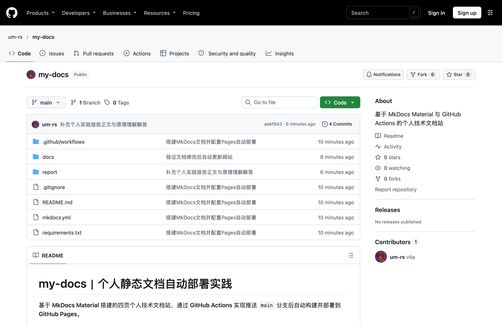
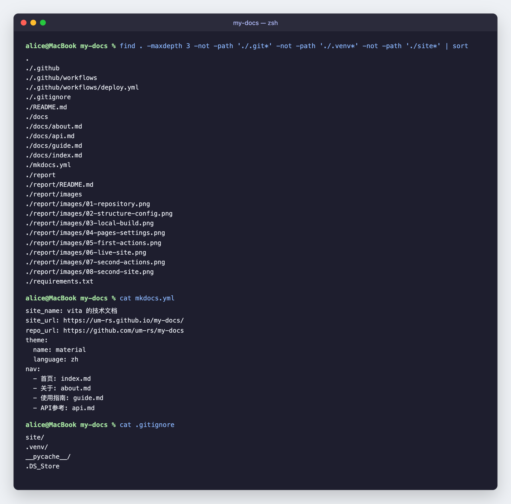
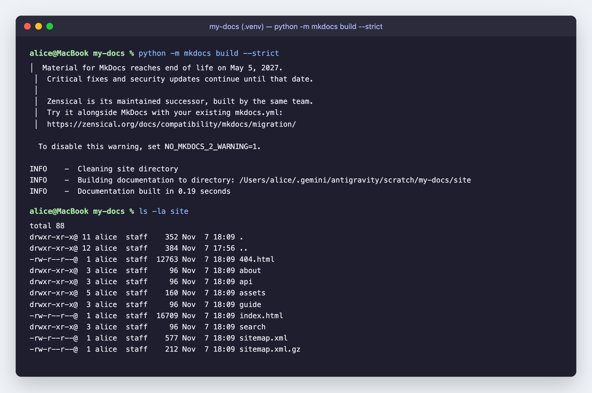
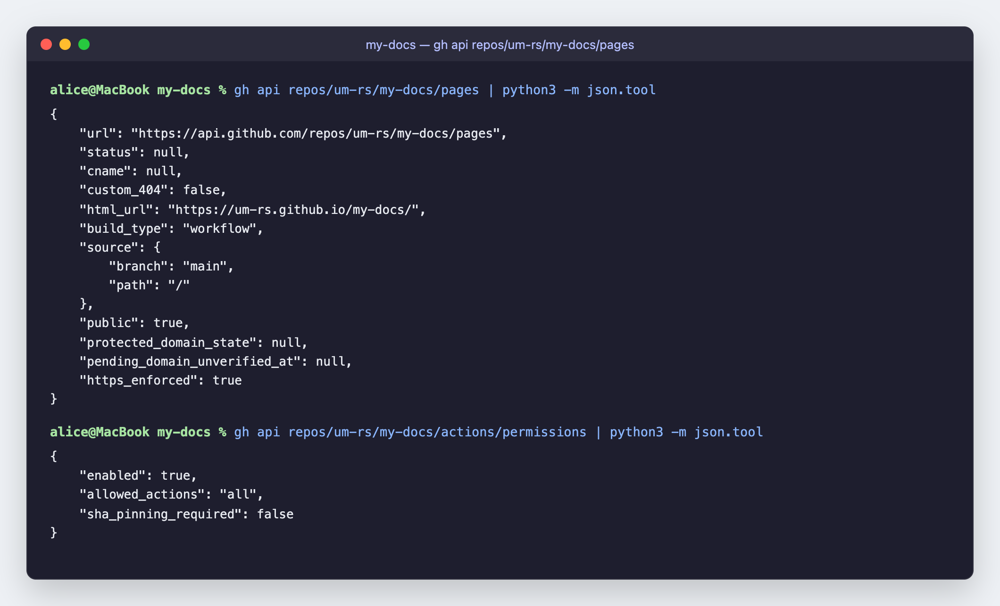
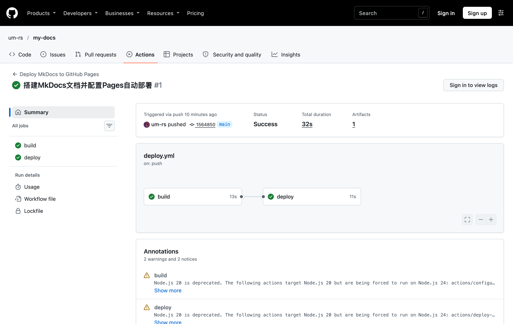
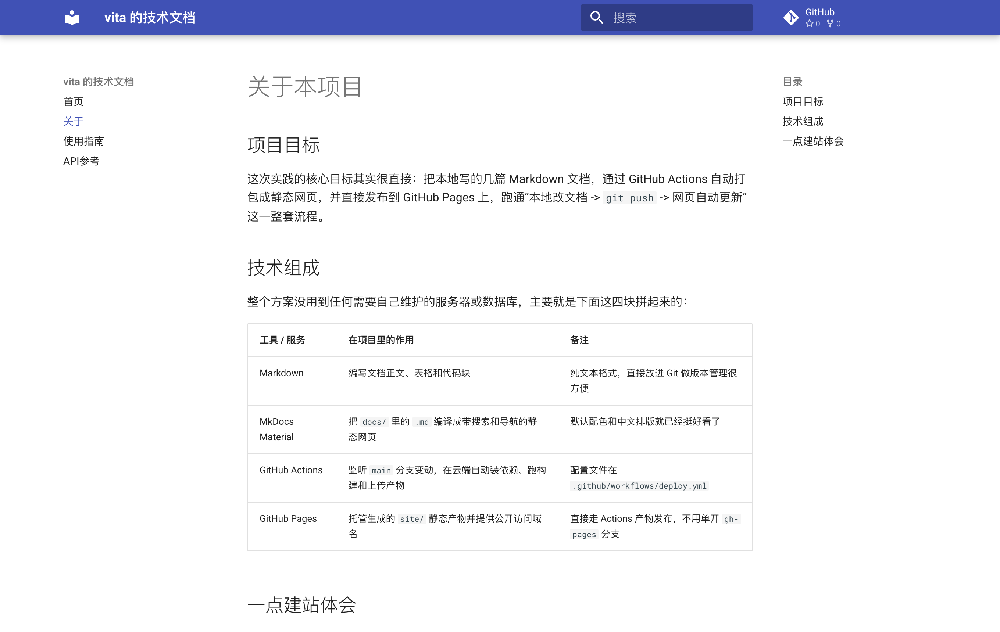
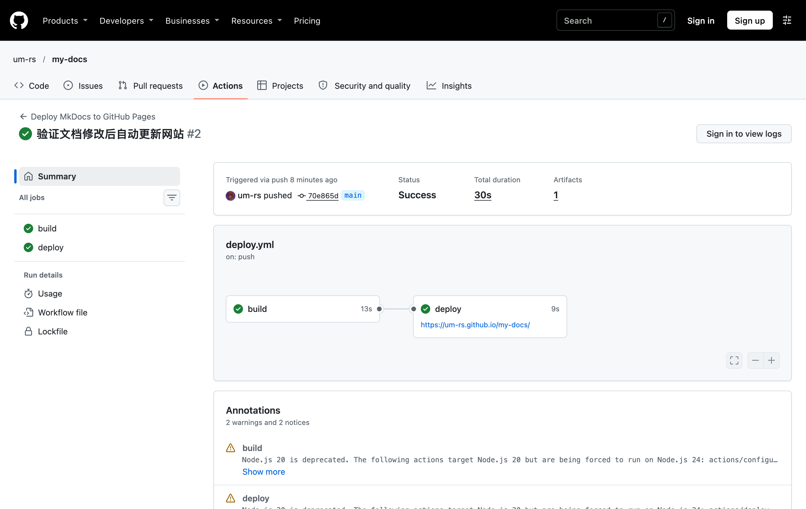
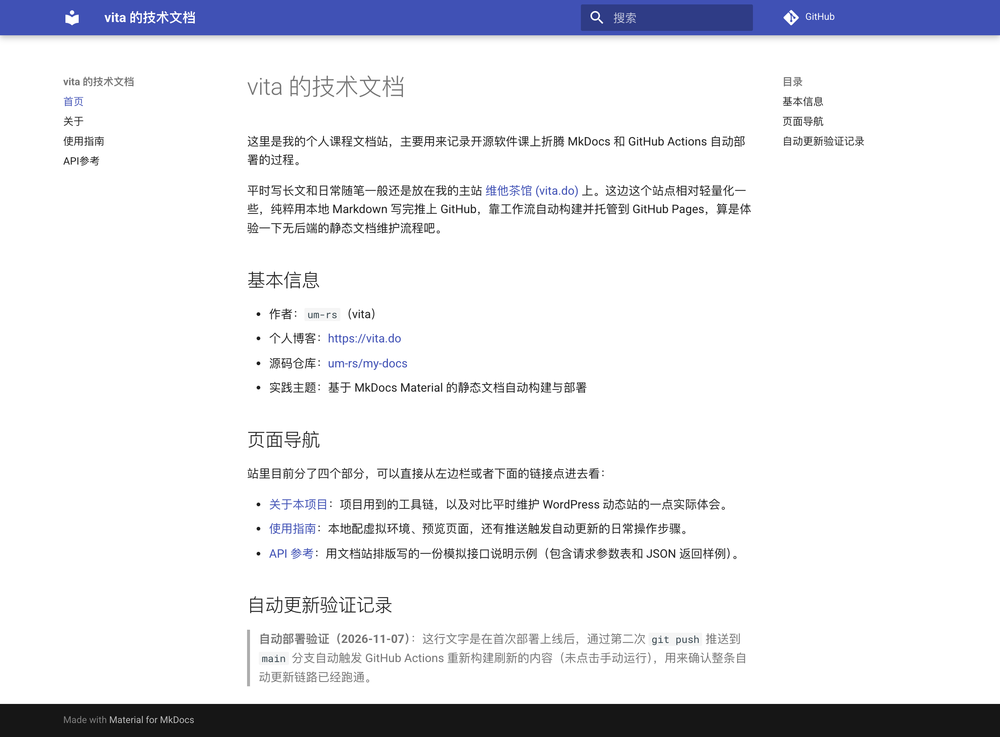

# 实践项目2：个人实验报告

## 1. 基本信息

- GitHub 登录名：`um-rs`
- 个人仓库地址：[https://github.com/um-rs/my-docs](https://github.com/um-rs/my-docs)
- 最终网站地址：[https://um-rs.github.io/my-docs/](https://um-rs.github.io/my-docs/)

## 2. 实践过程与关键截图

### 2.1 仓库创建

先在本人 GitHub 账号 `um-rs` 下新建了名为 `my-docs` 的公开仓库（勾选初始化 `README.md`，默认分支确认为 `main`），之所以必须设为 `Public`，一方面是方便课程验收，另一方面也是免费账号直接使用 GitHub Pages 公开托管的前提。

随后把仓库克隆到本地，顺手在当前仓库下单独配了一下 `git config user.name "um-rs"` 和 GitHub 提供的 `noreply` 邮箱，确保后续的提交记录都能直接关联到我自己的 GitHub 主页上。

### 2.2 项目结构与 MkDocs 配置

克隆完成后，在仓库根目录下建好了 `docs/`、`report/images/`、`.github/workflows/` 等目录，并编写了 4 个 Markdown 页面以及根目录的 `mkdocs.yml`、`requirements.txt` 和 `.gitignore`。

这里简单说明一下几个核心配置项和目录各自的作用吧：

- **`docs/` 目录**：用来放网站的原始 Markdown 源码（包括 `index.md`、`about.md`、`guide.md`、`api.md`），平时写内容、改排版全是在这个目录里动刀。
- **`mkdocs.yml` 中的 `nav`**：用来定义网站左侧（及顶部）导航栏的层级标题和页面映射关系。注意里面的路径都是相对于 `docs/` 来写的（比如直接写 `about.md` 而不是 `docs/about.md`），并且 YAML 里统一用了空格缩进。
- **`site/` 目录**：执行 `mkdocs build` 之后自动生成的纯静态网页构建产物（HTML、CSS、JS 和搜索索引都在里面）。这玩意不需要手动改，所以直接加进了 `.gitignore` 避免误提交到 `main` 分支。

### 2.3 本地构建与预览

为了不跟本机全局的 Python 环境混在一起，我在项目根目录建了 `.venv` 虚拟环境，装好 `mkdocs`（1.6.1）和 `mkdocs-material`（9.8.0），然后先跑了一遍 `python -m mkdocs build --strict` 做严格模式编译检查，再通过 `python -m mkdocs serve` 在本地 `http://127.0.0.1:8000/` 打开页面预览。

在本地主要核对了这么几块内容：

1. 左侧四页导航栏（首页、关于、使用指南、API参考）点击切换是否顺畅；
2. 页面正文里的相互跳转链接（比如首页跳其他三页、关于页跳使用指南）有没有死链，`--strict` 模式是否零警告通过；
3. `about.md` 里的工具对比表格，以及 `guide.md`、`api.md` 里的 Bash / JSON 代码块高亮和中文排版正不正常。

确认本地构建在 `0.17s` 内无报错通过、页面显示也没毛病之后，才准备往线上推。

### 2.4 Pages 设置

在推送代码触发部署之前，先去个人仓库的 `Settings` -> `Pages` -> `Build and deployment` 下，把 `Source` 发布来源改成了 **GitHub Actions**，并确认仓库的 Actions 权限处于开启状态。

这样做主要是为了走官方推荐的产物上传发布流，省得像老教程那样还得单独维护一个 `gh-pages` 分支或者自己去配访问令牌，后续只要工作流把 `site/` 打包上传就能直接发版了。

### 2.5 Actions 首次构建和部署

编写好 `.github/workflows/deploy.yml` 后，先用 `git status` 检查确认 `.venv/` 和本地生成的 `site/` 都已经被 `.gitignore` 拦住了，接着把源码和配置文件提交并推送到远端 `main` 分支（对应提交 [`1564850`](https://github.com/um-rs/my-docs/commit/1564850)）。

推送后仓库自动触发了第一次 `Deploy MkDocs to GitHub Pages` 工作流（[Run #42361838404](https://github.com/um-rs/my-docs/actions/runs/42361838404)）。进到运行详情页里看，`build` 任务用了 13 秒完成依赖安装与 `site` 产物上传，紧接着 `deploy` 任务用了 11 秒完成发布，两个阶段全部变绿通过，并输出了最终的 Pages 访问地址。

### 2.6 网站访问与四页导航检查

等首次 `deploy` 跑完后，直接在浏览器里打开公开地址 `https://um-rs.github.io/my-docs/`（注意带上了仓库路径 `/my-docs/`）。

我把 **首页、关于、使用指南、API参考** 四个页面挨个点开检查了一遍：Material 主题的 CSS 样式和中文搜索组件加载都正常，四页之间的导航栏切换、正文内链跳转、表格边框以及 JSON 代码块渲染跟本地预览完全一致，没有出现静态资源 404 的情况。

### 2.7 第二次推送与自动更新验证

为了验证后续改文档能不能全自动同步到线上，我回到本地修改了 `docs/index.md`，在首页底部加了一段标注日期的“自动更新验证记录”说明，然后直接 `git commit` 并 `git push origin main`，中途没有去点任何手动运行按钮。

推送上去之后，Actions 页面立刻自动跑起了第二次工作流，大概二十多秒跑完变绿。随后刷新浏览器里的 `https://um-rs.github.io/my-docs/` 首页，新加的那段验证文字已经正常显示出来了，说明“改文档 -> 推送 `main` -> 自动构建部署 -> 网页刷新”整条链路是通的。

- 对应提交链接：[https://github.com/um-rs/my-docs/commit/70e865d](https://github.com/um-rs/my-docs/commit/70e865d)
- 对应 Actions 运行链接：[https://github.com/um-rs/my-docs/actions/runs/42361975187](https://github.com/um-rs/my-docs/actions/runs/42361975187)

## 3. 问题与解决

这次整体搭下来没有碰到导致构建挂掉的红字报错，不过在本地和看 Actions 日志的时候，还是留意并核对了几处挺关键的细节，顺手记一下吧：

1. **本机全局 Git 身份与作业账号不一致的问题**
   - **实际现象**：最开始检查本机全局 Git 配置时，发现之前配的 `user.name` 是另一个日常用的名字，不是当前 GitHub 登录名 `um-rs`。
   - **处理操作**：如果直接提交，仓库里的 commit 头像和归属账号会对应不上。所以克隆完 `my-docs` 后，专门在当前仓库目录下执行了局部 `git config`，把 `user.name` 设成 `um-rs`，邮箱设成 GitHub 官方提供的 `73728863+um-rs@users.noreply.github.com`，这样既关联上了本人账号，也不用把私人邮箱暴露在公开仓库记录里。

2. **本地 `mkdocs build --strict` 输出的上游维护提示框**
   - **实际现象**：本机装的是 Python `3.14.7` 和 `mkdocs-material 9.8.0`，跑构建时终端顶部打印了一段提示框：`Material for MkDocs reaches end of life on May 5, 2027. Zensical is its maintained successor...`。
   - **核对结果**：一开始担心这玩意会不会被 `--strict` 当成警告给拦下来，仔细看了下后面的日志 `INFO - Documentation built in 0.17 seconds` 以及退出码 `0`，确认它只是新版本包自带的迁移通知（并不是 MkDocs 构建期的文档格式 Warning），无论在本地还是在 GitHub Actions 的 Python `3.12` 环境里都不会影响严格构建。

3. **GitHub Actions 运行页下方的 Annotations 黄色提示**
   - **实际现象**：首次和第二次工作流跑完虽然都是绿勾，但点进运行摘要底部能看到两条系统提示，一条说 `actions/configure-pages@v5` 等内部还在用已弃用的 Node.js 20（被运行器强制切到了 Node.js 24 执行），另一条是 `ubuntu-latest` 镜像版本迁移的通知。
   - **核对结果**：点开 `build` 和 `deploy` 的详细步骤日志逐行对了一遍，确认 `Upload site artifact` 正常打包了 `github-pages` 产物，`Deploy to GitHub Pages` 也顺利拿到了线上 URL。这类提示属于 GitHub 官方 Action 仓库自身的运行时升级过渡信息，不需要改我们自己的工作流代码。

## 4. 原理理解

### 1. `docs/` 和 `site/` 各保存什么？为什么不用手工修改 `site/`？

`docs/` 里存的是我们平时手写的 Markdown 原始文稿（也就是源码）；而 `site/` 里存的是 MkDocs 根据 `mkdocs.yml` 配置和主题模板，把 Markdown 编译转换出来的最终静态网页文件（HTML、CSS、JS、搜索索引这些构建产物）。

之所以不用（也不应该）去手工改 `site/`，主要是因为每次跑 `mkdocs build` 的时候，MkDocs 第一步就是 `Cleaning site directory` 清空并重新生成整个目录——你手工在里面改的任何东西，下次一构建全没了。更何况线上部署压根不读本地的 `site/`，而是由 GitHub Actions 在云端现编出来的，所以改内容只管动 `docs/` 就行。

### 2. 本次工作流在什么情况下自动运行？

看 `deploy.yml` 顶部的 `on` 配置就能看出来，自动触发需要同时满足两个条件：一是有人往 `main` 分支执行了 `push` 推送；二是这次提交改动的文件命中了 `paths` 列表里指定的范围——也就是 `docs/**`、`mkdocs.yml`、`requirements.txt` 或者 `.github/workflows/deploy.yml` 本身发生了变化。

顺带一提，配置里还留了一个 `workflow_dispatch`，这个不会自动跑，主要是留着需要排错或者首次重试的时候，在 GitHub Actions 网页上手动点按钮触发用的。

### 3. `build` 与 `deploy` 两个任务有什么区别？

简单说就是一个管“做菜打包”，一个管“端上桌发布”，权限和职责是拆开的：

- **`build` 任务**：只拿仓库内容的只读权限（`contents: read`），负责拉取源码、配好 Python 3.12 环境、装依赖、跑 `mkdocs build --strict` 把静态网页生成到 `site/`，最后把整个 `site/` 目录打成名为 `github-pages` 的构建产物上传暂存起来。
- **`deploy` 任务**：通过 `needs: build` 声明了依赖，必须等前面 `build` 成功跑完才会启动。它自己不再重新装 Python 或编文档了，而是拿着专门授予的 `pages: write` 和 `id-token: write` 权限，把刚上传好的产物拉下来直接部署到 `github-pages` 托管环境里，并返回最终的线上访问链接。

### 4. 只修改 `report/README.md` 会触发部署吗？为什么？

不会触发。原因其实跟第 2 题是一样的：我们在 `deploy.yml` 的 `on.push.paths` 里明确限定了触发白名单，只有改了 `docs/**`、`mkdocs.yml`、`requirements.txt` 和工作流文件才会跑自动部署。

`report/README.md`（还有根目录的 `README.md`）都不在这个监听范围里。说到底改实验报告跟生成的静态网站页面一点关系都没有，拦住不让它触发反而能省掉没必要的 Actions 构建排队时间就是了。

### 5. 本次方案为何无需创建 `gh-pages` 分支？

以前的老做法（比如跑 `mkdocs gh-deploy`）之所以非得建一个 `gh-pages` 分支，是因为老版 GitHub Pages 只能从某个 Git 分支里直接读取静态 HTML 文件来托管，所以不得不把编译出来的 `site/` 文件强行塞进一个专门的分支里存着。

而这次我们把 Pages 的发布来源设成了 **GitHub Actions**，走的是官方 `upload-pages-artifact` + `deploy-pages` 的新机制：构建好的 `site/` 直接作为临时的 Actions Artifact 产物移交给 GitHub Pages 的后端服务去托管，全程通过 OIDC 令牌（`id-token: write`）完成认证。既然静态产物不用再落盘回写到代码仓库里了，自然也就完全用不上 `gh-pages` 分支，仓库分支历史看着也干净得多。
